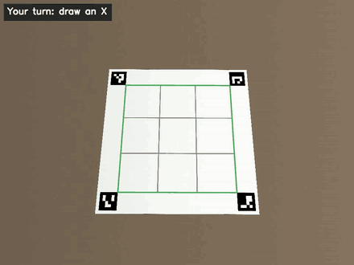
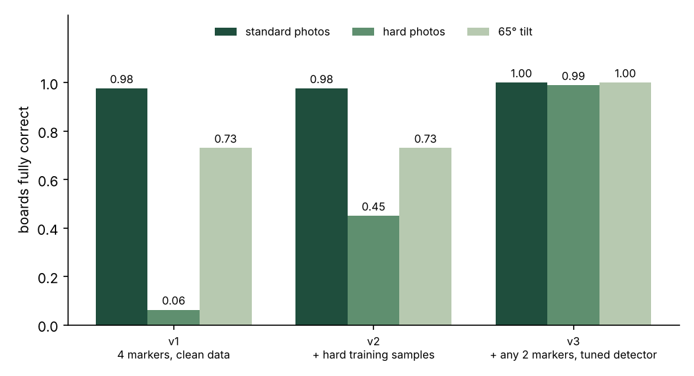

# TicTacToe Vision

> **Context:** a 2025 master's project at Université Ibn Tofail (Master IA et Objets Connectés). I took it up again and adapted it in 2026 before publishing it here.

Play tic-tac-toe **on paper** against an AI that never loses. A camera reads the board, a small CNN recognises each cell, a negamax engine picks the reply, and the move is drawn back onto the image as an AR overlay.

C++17 · OpenCV (ArUco, DNN) · PyTorch → ONNX · CMake · doctest

<p align="center"></p>

<p align="center"><sub>Synthetic game rendered by <code>python/demo_video.py</code> and annotated by the C++ app. The engine plays O; the game ends in a draw, as it must against perfect play.</sub></p>

## Results

Evaluated on synthetic photos that were never seen in training (`python/evaluate.py`, `results/evaluation.json`):

| Test set | Photos | Board found | Cells correct | Boards fully correct |
|---|---|---|---|---|
| Standard photos (tilt 0–45°, blur, shadows, JPEG) | 1,000 | 100 % | 100 % | 100 % |
| Hard photos (faint thin strokes, small board, strong blur) | 1,000 | 100 % | 99.8 % | 98.9 % |
| Tilt sweep 0° → 65° | 6 × 200 | 100 % | 100 % | 100 % |

| | |
|---|---|
| C++ and Python pipelines agree | 60 / 60 test photos |
| Board reading (detection + 9-cell CNN), 960×720, 2 CPU cores | 47 ms median, 115 ms p95 |
| AI move | < 0.02 ms median |
| Engine | never loses: all 569 games where the human tries every possible move (`tests/test_game.cpp`) |
| Model | 89 k parameters, 359 KB ONNX |

### What made the difference



1. **v1**: the 4 inner marker corners give the homography, and the model is trained on clean strokes. It reaches 98 % on standard photos but drops to 6 % on hard ones: faint pencil-like marks are read as empty cells.
2. **v2**: 30 % of the training photos use the hard settings. Cell accuracy on hard photos goes back to 100 %, so the remaining failures all come from board detection.
3. **v3**: every visible marker adds its 4 corners to a least-squares homography, so 2 markers out of 4 are enough. The ArUco detector is also tuned for small, blurred markers. This fixes boards cut off by the frame or partly covered by a hand, and steep 65° tilts.

## How it works

```
frame ─► ArUco markers ─► homography (≥ 2 markers, 4–16 points) ─► 300×300 top view
      ─► 9 cell crops (12 % inner margin) ─► ink normalisation ─► CNN (ONNX, OpenCV DNN)
      ─► GameTracker: stable over 6 frames, confidence ≥ 0.8, legal transition only
      ─► negamax + alpha-beta + transposition table ─► AR overlay via inverse homography
```

- **Board.** The four ArUco markers (DICT_4X4_50, ids 0–3) frame a 150 mm playing area. Their geometry is known, so each detected marker gives 4 point correspondences.
- **Cells.** Each crop is turned into an "ink map": darkness relative to the local paper colour, which is the 90th-percentile pixel. This removes lighting gradients and shadows before the CNN sees the cell. The same formula is implemented in Python and C++, including the percentile index.
- **CNN.** 3 conv blocks (16/32/64 channels) and a small MLP, with 3 classes: empty, X, O. It is trained in PyTorch on rendered photos of hand-drawn marks with random camera, lighting, shadows, blur, noise and JPEG compression, then exported to ONNX and run by OpenCV DNN in C++.
- **Tracking.** A move counts only if the same board is read on 6 consecutive confident frames and is a legal successor of the previous state. A hand passing over the board, a half-drawn mark or a misread frame never changes the game, and an illegal change raises a warning.
- **Engine.** Negamax with alpha-beta pruning. The transposition table only caches exact values, never bounds. The engine prefers faster wins and slower losses.

## Play

1. Print `board/board.pdf` at 100 % scale.
2. Run `ttt_vision --camera 0` and point a webcam at the sheet.
3. Draw an X. When the AI move is highlighted, draw the O for it.

```bash
ttt_vision --camera 0                                   # live
ttt_vision --image data/test/photo_200000.jpg --out o.jpg
ttt_vision --video game.mp4 --out annotated.mp4 --no-window
ttt_bench models/cellnet.onnx data/test/*.jpg          # latency
```

## Build

Requirements: CMake ≥ 3.16, a C++17 compiler, and OpenCV ≥ 4.5 with the contrib modules (`aruco`) and `dnn`.

**Linux / WSL**
```bash
sudo apt install build-essential cmake libopencv-dev libopencv-contrib-dev
cmake -S . -B build -DCMAKE_BUILD_TYPE=Release
cmake --build build -j
./build/ttt_tests
```

**Windows (vcpkg)**
```powershell
vcpkg install opencv4[contrib,dnn]:x64-windows
cmake -S . -B build -DCMAKE_TOOLCHAIN_FILE=<vcpkg>/scripts/buildsystems/vcpkg.cmake
cmake --build build --config Release
```

## Reproduce the model

```bash
pip install -r python/requirements.txt
python python/board.py         # printable board
python python/train.py         # 4,000 synthetic photos, 12 epochs, writes models/cellnet.onnx
python python/evaluate.py      # results/evaluation.json, data/test/
python python/demo_video.py    # synthetic game video for the demo
```

## Repository

```
include/ttt, src/   game rules, engine, board reader, tracker, app, benchmark
tests/              rules, perfect play, tracker stability (doctest)
python/             board generator, photo synthesis, training, evaluation, demo
models/             cellnet.onnx
results/            metrics and figures
board/              printable board (PDF, PNG)
```

## Limitations

- **Synthetic data only.** All results come from rendered photos. Real paper, pens and cameras differ: glare, ruled or coloured paper, very thick markers. The next step is a small set of real photos to measure the gap and fine-tune.
- The tracker assumes the human plays X and moves first.
- Board reading runs on every frame. Tracking the markers between frames would cut CPU use on small devices.

## License

MIT
